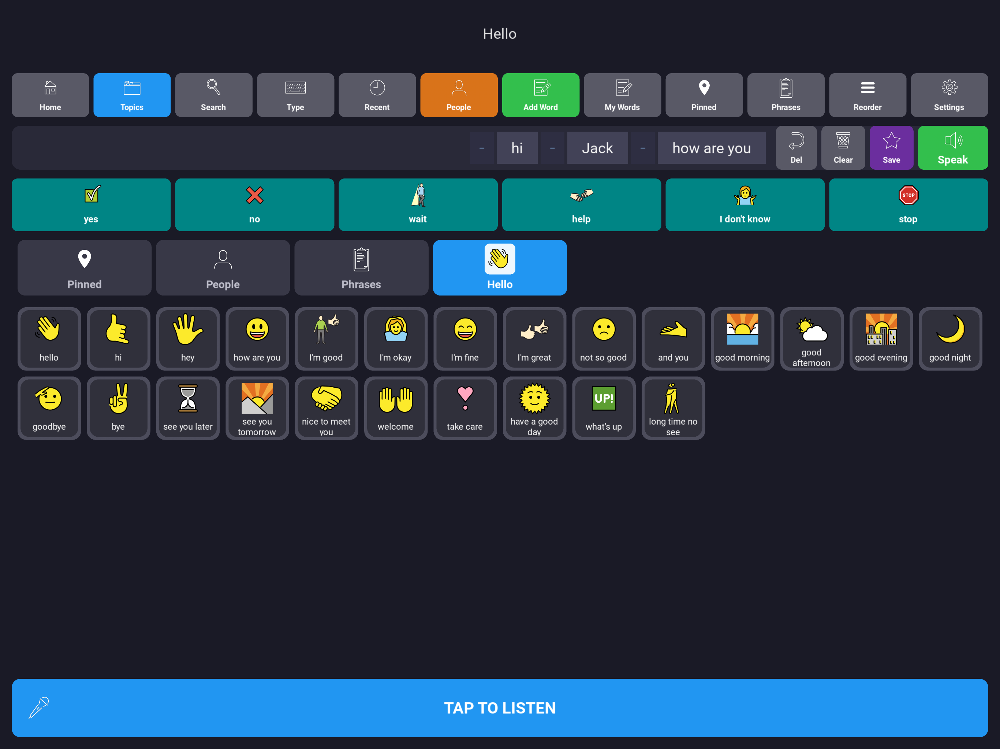
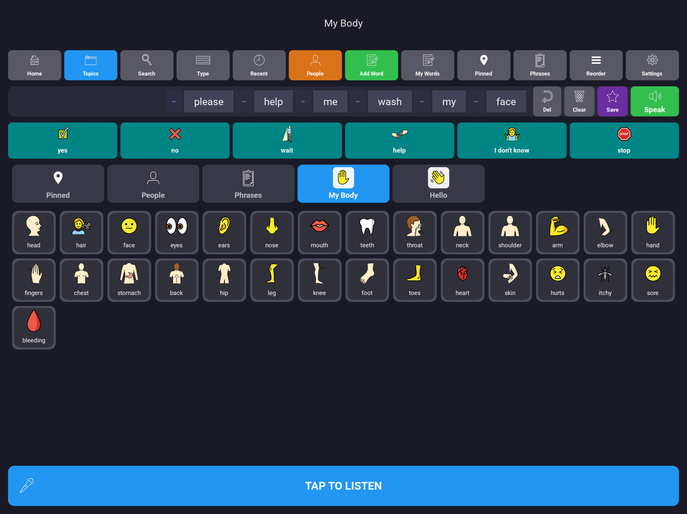
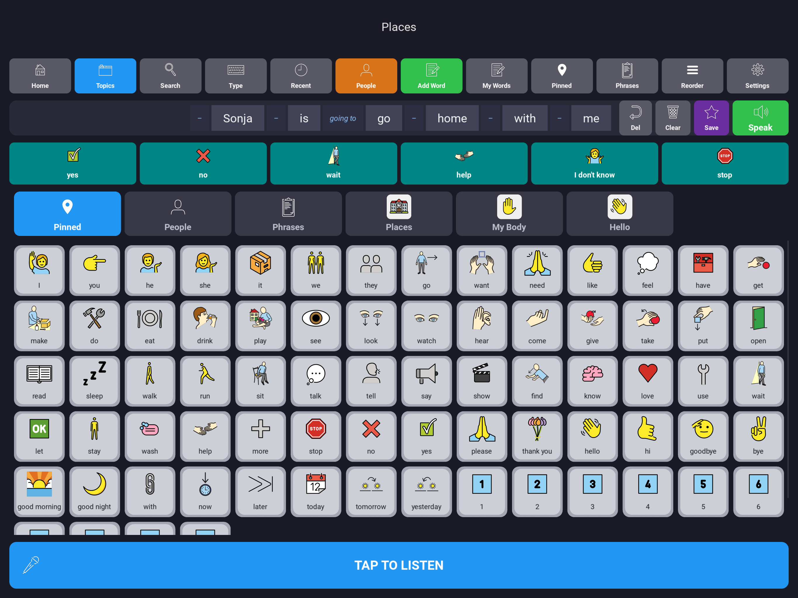
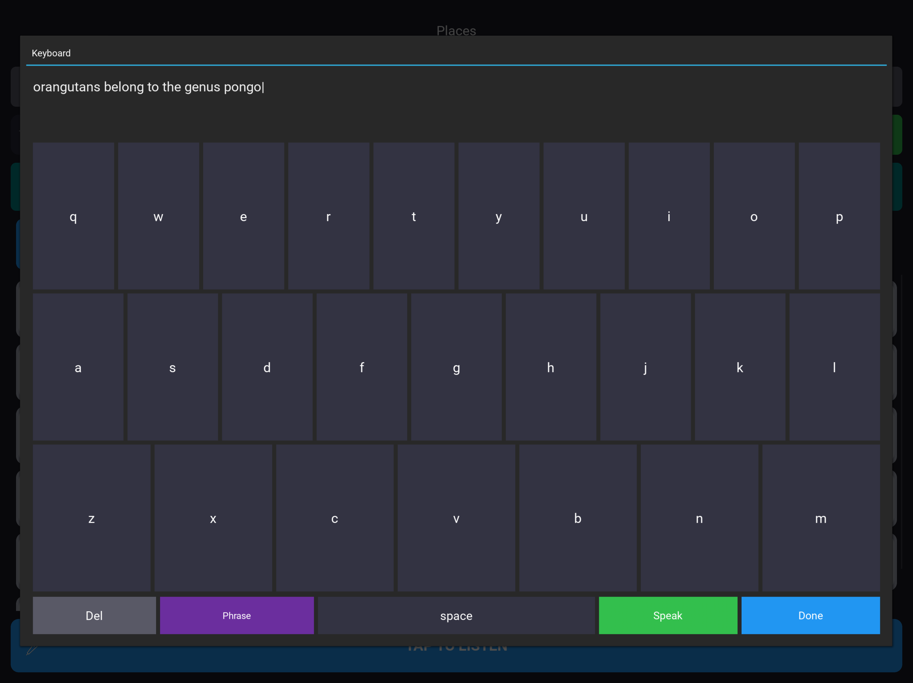
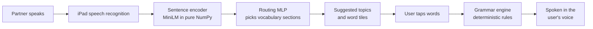

# EZConversation

**An AI-assisted communication app for people who communicate by tapping instead of speaking.** EZConversation is an iPad AAC (augmentative and alternative communication) app built for non-verbal autistic people and other AAC users. It listens to the person they're talking with, brings up the words a reply is likely to need, and fills in the grammar, so a few taps become a whole spoken sentence.

> **Status:** pre-launch · [ezconversation.com](https://ezconversation.com). This is a showcase repository: the source code is private, and this page documents what the app does and how it is built.

  
  

---

## Why it exists

Many AAC users spend a conversation digging through menus for the right word while the other person waits. They also have to build every sentence word by word, including the small words. EZConversation tackles both problems:
- **Listening** puts the likely words within reach before the user starts looking.
- **The grammar engine** turns the words that matter into fluent English.

## Tap a few words, speak a whole sentence

| User taps | App speaks |
| --- | --- |
| I · want · cookie | "I want a cookie" |
| yesterday · I · go · store | "yesterday I went to the store" |
| I · no · like · it | "I don't like it" |
| leg · hurt | "my leg hurts" |
| where · he · go | "where does he go" |

The engine adds the small words (*a, the, to, and*), fixes verb endings, handles past and future, builds questions and negatives, and works out *I / me / my*, so nobody has to learn them first. Every word it adds appears as a grey chip that can be turned off with a tap. In the screenshot below, the user tapped *Sonja · is · go · home · with · me*, and the app added *going to*.

  
  

## Features

- **Tap to Listen.** The other person speaks, and the app brings up the vocabulary the user is most likely to want for a reply. That includes names and places that came up in the conversation, like "New York," even if they aren't in the app yet. **It never answers, chooses or speaks for the user.** It only puts likely words within reach.
- **Instant Words.** *yes, no, wait, help, I don't know* and *stop* are always on screen. Tapping one speaks it right away, without adding it to the sentence bar.
- **Vocabulary that's quick to reach**
  - Pinned core words that never move
  - 25 picture-first topics, from Food and Feelings to Not Well, School and Money
  - 500+ built-in words, most with pictures
  - Search across every word
  - A keyboard with predictions that learn from what this user says
- **Personalization**
  - People & Pets, with photos on their tiles
  - Custom words with the user's own photos, filed into the right topic
  - Saved phrases and drag-to-arrange tiles
  - Recent: re-speak or edit any of the last 50 sentences
- **A voice that's theirs.** Users build a voice from an age, a vocal quality, and speed, pitch and volume settings. Every change plays a sample straight away.
- **Access options**
  - Three tile sizes
  - Hold-to-preview with an adjustable hold time
  - Filtering for repeated taps, which helps with tremor
  - Optional speech on every tap
- **For parents, teachers and SLPs**
  - Supporter modeling, so an adult can demonstrate without their sentences counting as the user's
  - Settings and words backed up to the account, so they follow the user to another iPad
  - An invite-only browser usage report showing counts and trends, not transcripts, that the user can revoke at any time

## Private by design

- The tiles, the grammar engine and the voice all work **with no internet connection**.
- Only Tap to Listen uses speech recognition, through the iPad's own built-in speech recognizer. It listens only while the button is pressed, and the app never stores audio.

## How it works

### On-device language understanding
- I **reimplemented the `all-MiniLM-L6-v2` sentence encoder in pure NumPy**: the full BERT forward pass and the WordPiece tokenizer. I checked its output against the PyTorch reference.
- The **routing model** is an MLP trained in PyTorch on an LLM-labeled corpus and also ported to NumPy. It predicts which of **26 vocabulary sections** a reply needs.
- Since nothing depends on PyTorch at runtime, inference runs **entirely on the iPad**.

### Grammar engine
- The engine is **deterministic and rule-based**, not an LLM, so its output is predictable and it never puts words in the user's mouth.
- It runs **clause segmentation**, then an **ordered pipeline of rules** for agreement, tense, articles, copulas and case.
- It's tested against a **~1,000-case corpus** and a **blind validation set**.

### Backend
Built serverless on AWS with SAM:
- **Lambda** and **API Gateway** for the API, **Cognito** for accounts
- **DynamoDB**, **SQS**, and **S3/CloudFront** for data, queued work and file delivery
- **KMS-signed license codes** for schools and clinics, and **Stripe webhooks** for payments
- **Offline-first sync** of settings, words and phrases
- **260+ pytest tests**

## Tech stack

| Area | Tools |
| --- | --- |
| App | Python, Kivy (kivy-ios), iPad |
| ML | PyTorch (training), NumPy (on-device inference), sentence embeddings, LLM-labeled training data |
| Language | Rule-based grammar engine, WordPiece tokenization, iOS speech recognition |
| Backend | AWS SAM, Lambda, API Gateway, Cognito, DynamoDB, SQS, S3, CloudFront, KMS, Stripe |
| Testing | pytest |

*EZConversation is a communication tool, not a medical device. It works best alongside guidance from a speech-language pathologist.*
